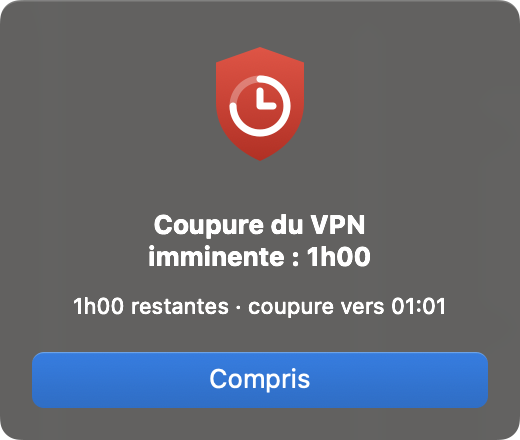

<p align="center">
  
</p>

<h1 align="center">forti-watch</h1>

<p align="center">
  <a href="https://github.com/loicjazon/forti-watch/actions/workflows/ci.yml"></a>
</p>

Petit outil de bureau pour **Linux et macOS** (Intel et Apple Silicon) qui affiche le **temps de connexion
restant du VPN FortiClient** et vous **prévient avant la coupure** de la session.

Beaucoup de VPN d'entreprise coupent la session au bout d'une durée fixe (8 h par défaut ici). `forti-watch`
tourne en tâche de fond, lit l'heure de connexion que donne FortiClient, montre le temps restant dans la
**barre supérieure** du bureau (la **barre des menus** sur Mac) et ouvre une fenêtre d'alerte quand il reste
**1 h**, puis **15 min**, avant la coupure (avec l'heure prévue).

Page de présentation : <https://loicjazon.github.io/forti-watch/>

## Aperçu

L'indicateur de la barre supérieure, selon la situation :

| Connecté (temps restant) | Moins de 15 min | VPN coupé |
|---|---|---|
|  |  |  |

La fenêtre d'alerte, ouverte 1 h puis 15 min avant la coupure (sur Mac, une seule à la fois : elle se met à
jour si une autre arrive) :

| Linux | macOS |
|---|---|
|  |  |

## Prérequis

### Linux

- Ubuntu **22.04 ou plus récent** (glibc 2.35 minimum), avec un environnement graphique (GNOME testé).
- GTK3, présent par défaut sur Ubuntu. Sinon : `sudo apt install libgtk-3-0`.
- **FortiClient** installé dans `/opt/forticlient/` : `forti-watch` lit la durée de connexion avec
  `/opt/forticlient/forticlient-cli` (testé avec FortiClient 7.4.3).
- Pour l'indicateur de la barre : l'extension GNOME « AppIndicator » (activée par défaut sur Ubuntu) et
  `libayatana-appindicator3-1` (`sudo apt install libayatana-appindicator3-1` si besoin). Sans eux, seules
  les fenêtres d'alerte fonctionnent.

### macOS

- macOS **11 ou plus récent**, Intel ou Apple Silicon (testé sur macOS 15 Intel).
- **FortiClient** avec son VPN installé (testé avec FortiClient 7.4.3) : `forti-watch` lit l'état et l'heure de
  connexion du VPN avec l'outil système `scutil --nc`, sans droits administrateur.

## Installation

```bash
curl -fsSL https://raw.githubusercontent.com/loicjazon/forti-watch/main/install.sh | sh
```

La même commande sert pour Linux et macOS. Le script, sans `sudo` :

- télécharge la dernière release pour votre système et vérifie son empreinte SHA-256 ;
- la copie dans `~/.local/bin/forti-watch` ;
- la lance à chaque ouverture de session : `~/.config/autostart/forti-watch.desktop` sous Linux, LaunchAgent
  `~/Library/LaunchAgents/io.github.loicjazon.forti-watch.plist` sur Mac (journal dans
  `~/Library/Logs/forti-watch.log`) ;
- la démarre immédiatement.

Relancer la même commande met à jour vers la dernière version. Vous pouvez lire le script avant de l'exécuter :
[`install.sh`](install.sh).

## Mise à jour automatique

Une fois installé, `forti-watch` se met à jour tout seul : 30 secondes après son démarrage puis toutes les 6 h, il
cherche une release plus récente sur GitHub, télécharge le binaire, **vérifie son empreinte SHA-256**, remplace
`~/.local/bin/forti-watch` et se relance. En cas d'échec (réseau, empreinte différente), la version installée reste
intacte et l'essai est renouvelé plus tard.

- Pour ne pas rejouer une alerte, la relance attend la fin de la session VPN quand il reste moins d'une heure ;
  sinon elle a lieu à la prochaine ouverture de session.
- Désactiver : définir `FORTI_WATCH_NO_UPDATE=1` dans l'environnement du lancement.
- Les versions antérieures à cette fonction ne savent pas se mettre à jour : relancez une fois la commande
  d'installation.

## Désinstallation

```bash
curl -fsSL https://raw.githubusercontent.com/loicjazon/forti-watch/main/install.sh | sh -s -- --uninstall
```

## Fonctionnement

- Toutes les minutes, `forti-watch` lit le **début réel de la connexion** : la durée affichée par
  `forticlient-cli vpn status` sous Linux, l'heure de passage à « connecté » (`LastStatusChangeTime`) de
  `scutil --nc status` sur Mac. La session se termine donc à « début réel de la connexion + 8 h », même si
  `forti-watch` est lancé ou relancé en cours de session.
- Une alerte par seuil (1 h, puis 15 min). Si vous démarrez l'outil alors qu'il reste déjà moins d'1 h, seule
  l'alerte du seuil le plus bas est déclenchée.
- Une déconnexion efface la session ; la prochaine connexion repart à zéro.

### Indicateur de la barre supérieure

Le logo de forti-watch suivi d'un texte, en haut à droite de l'écran, mis à jour chaque
minute :

| Situation | Texte |
|---|---|
| Connecté | `54 min` ou `1h05` (temps restant) |
| VPN coupé | `VPN off` |
| FortiClient illisible | `VPN ?` |

Le clic ouvre un menu : heure de coupure, durée de connexion, et **Quitter forti-watch** (il redémarrera à la
prochaine ouverture de session).

### Limites

- Si FortiClient est introuvable ou répond de façon inattendue, `forti-watch` ne peut pas alerter : l'erreur est
  écrite une seule fois sur la sortie d'erreur et il réessaie chaque minute.
- Seul FortiClient est pris en charge (pas d'autre client VPN).
- Sur Mac, une reconnexion du VPN (après une mise en veille, un changement de réseau) compte comme une nouvelle
  session : FortiClient y redemande l'authentification.
- La durée de session (8 h) et les seuils d'alerte sont en dur dans `src/config.rs` : modifiez-les puis recompilez
  si votre VPN utilise une autre limite.

### Tester les alertes

Pour voir la fenêtre sans attendre l'heure de l'alerte, lancez-le avec une alerte par minute (arrêtez d'abord
l'instance en cours avec `pkill forti-watch`) :

```bash
FORTI_WATCH_TEST_EVERY_MINUTE=1 forti-watch
```

La variable `FORTI_WATCH_CLI` remplace le chemin de `forticlient-cli` sous Linux (pratique pour tester avec un
faux script qui affiche `Status: Connected` et une ligne `Duration: HH:MM:SS`), et celui de `scutil` sur Mac.

## Développement

```bash
cargo test                 # logique de session, analyse de FortiClient et de scutil, textes de l'indicateur
cargo clippy --all-targets
cargo build --release      # binaire dans target/release/forti-watch
```

Sous Linux, la compilation nécessite les en-têtes GTK3 : `sudo apt install libgtk-3-dev`. Sur Mac, les outils en
ligne de commande de Xcode suffisent (`xcode-select --install`).

Organisation du code :

| Fichier | Rôle |
|---|---|
| `src/main.rs` | Vérification chaque minute : état du VPN, session, indicateur, alerte, mise à jour |
| `src/linux/`, `src/macos/` | Interface propre à chaque système : boucle d'événements, indicateur, alerte |
| `src/tray.rs` | Texte et menu de l'indicateur (fonctions pures testées) |
| `src/session.rs` | Suivi de la session et des seuils (testé) |
| `src/vpn/` | Lecture de `forticlient-cli vpn status` (Linux) et de `scutil --nc` (macOS), analyses testées |
| `src/update.rs` | Mise à jour automatique |
| `src/config.rs` | Commande lue, intervalle, durée de session, seuils, nom du binaire publié |
| `install.sh` | Installateur : télécharge, vérifie et installe la dernière release |
| `.github/workflows/` | CI (tests) et publication des releases |

## Publier une nouvelle version

Les binaires ne sont pas dans git : GitHub Actions les compile et les publie dans une release GitHub
(`install.sh` télécharge `releases/latest`) :

- Linux dans un conteneur **Ubuntu 22.04**, pour ne pas exiger une glibc plus récente que celle de la version
  minimale supportée ;
- macOS sur un runner macOS : un binaire **universel** (Intel + Apple Silicon, assemblé par `lipo`, signature
  ad hoc), pour macOS 11 et plus.

```bash
# 1. aligner la version de Cargo.toml (et Cargo.lock) sur le tag, puis commiter
git tag v1.1.0
git push origin v1.1.0
```

Le workflow `Release` refuse un tag qui ne correspond pas à la version de `Cargo.toml`.

## Licence

[MIT](LICENSE)
