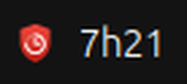
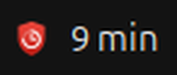
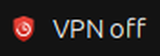
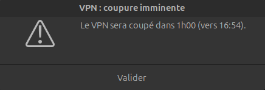

<p align="center">
  
</p>

<h1 align="center">forti-watch</h1>

Petit outil de bureau Linux qui affiche le **temps de connexion restant du VPN FortiClient** et vous
**prévient avant la coupure** de la session.

Beaucoup de VPN d'entreprise coupent la session au bout d'une durée fixe (8 h par défaut ici). `forti-watch`
tourne en tâche de fond, lit la durée de connexion que FortiClient affiche (champ « Duration »), montre le temps
restant dans la **barre supérieure** du bureau et ouvre une fenêtre d'alerte quand il reste **1 h**, puis
**15 min**, avant la coupure (avec l'heure prévue).

Page de présentation : <https://loicjazon.github.io/forti-watch/>

## Aperçu

L'indicateur de la barre supérieure, selon la situation :

| Connecté (temps restant) | Moins de 15 min | VPN coupé |
|---|---|---|
|  |  |  |

La fenêtre d'alerte, ouverte 1 h puis 15 min avant la coupure :



## Prérequis

- Ubuntu **22.04 ou plus récent** (glibc 2.35 minimum), avec un environnement graphique (GNOME testé).
- GTK3, présent par défaut sur Ubuntu. Sinon : `sudo apt install libgtk-3-0`.
- **FortiClient** installé dans `/opt/forticlient/` : `forti-watch` lit la durée de connexion avec
  `/opt/forticlient/forticlient-cli` (testé avec FortiClient 7.4.3).
- Pour l'indicateur de la barre : l'extension GNOME « AppIndicator » (activée par défaut sur Ubuntu) et
  `libayatana-appindicator3-1` (`sudo apt install libayatana-appindicator3-1` si besoin). Sans eux, seules
  les fenêtres d'alerte fonctionnent.

## Installation

```bash
curl -fsSL https://raw.githubusercontent.com/loicjazon/forti-watch/main/install.sh | sh
```

Le script, sans `sudo` :

- télécharge la dernière release et vérifie son empreinte SHA-256 ;
- la copie dans `~/.local/bin/forti-watch` ;
- ajoute `~/.config/autostart/forti-watch.desktop` pour la lancer à chaque ouverture de session ;
- la démarre immédiatement.

Relancer la même commande met à jour vers la dernière version. Vous pouvez lire le script avant de l'exécuter :
[`install.sh`](install.sh).

## Désinstallation

```bash
curl -fsSL https://raw.githubusercontent.com/loicjazon/forti-watch/main/install.sh | sh -s -- --uninstall
```

## Fonctionnement

- Toutes les minutes, `forti-watch` exécute `forticlient-cli vpn status` et lit la **durée de connexion**.
  La session se termine donc à « début réel de la connexion + 8 h », même si `forti-watch` est lancé ou relancé en
  cours de session.
- Une alerte par seuil (1 h, puis 15 min). Si vous démarrez l'outil alors qu'il reste déjà moins d'1 h, seule
  l'alerte du seuil le plus bas est déclenchée.
- Une déconnexion efface la session ; la prochaine connexion repart à zéro.

### Indicateur de la barre supérieure

Le logo de forti-watch suivi d'un texte, en haut à droite de l'écran, mis à jour chaque minute :

| Situation | Texte |
|---|---|
| Connecté | `54 min` ou `1h05` (temps restant) |
| VPN coupé | `VPN off` |
| FortiClient illisible | `VPN ?` |

Le clic ouvre un menu : heure de coupure, durée de connexion, et **Quitter forti-watch** (il redémarrera à la
prochaine ouverture de session).

### Limites

- Si FortiClient est introuvable ou répond de façon inattendue, `forti-watch` ne peut pas alerter : l'erreur est
  écrite une seule fois sur la sortie d'erreur et il réessaie chaque minute.
- Seul FortiClient est pris en charge (pas d'autre client VPN).
- La durée de session (8 h) et les seuils d'alerte sont en dur dans `src/config.rs` : modifiez-les puis recompilez
  si votre VPN utilise une autre limite.

### Tester les alertes

Pour voir la fenêtre sans attendre l'heure de l'alerte, lancez-le avec une alerte par minute (arrêtez d'abord
l'instance en cours avec `pkill forti-watch`) :

```bash
FORTI_WATCH_TEST_EVERY_MINUTE=1 forti-watch
```

La variable `FORTI_WATCH_CLI` remplace le chemin de `forticlient-cli` (pratique pour tester avec un faux script
qui affiche `Status: Connected` et une ligne `Duration: HH:MM:SS`).

## Développement

```bash
cargo test                 # logique de session, analyse de FortiClient, textes de l'indicateur
cargo clippy --all-targets
cargo build --release      # binaire dans target/release/forti-watch
```

La compilation nécessite les en-têtes GTK3 : `sudo apt install libgtk-3-dev`.

Organisation du code :

| Fichier | Rôle |
|---|---|
| `src/main.rs` | Boucle GTK (vérification chaque minute) et fenêtre d'alerte |
| `src/tray.rs` | Indicateur de la barre supérieure (texte et menu : fonctions pures testées) |
| `src/session.rs` | Suivi de la session et des seuils (testé) |
| `src/vpn.rs` | Lecture de `forticlient-cli vpn status` (analyse pure et testée) |
| `src/config.rs` | Chemin de la CLI, intervalle, durée de session, seuils |
| `install.sh` | Installateur : télécharge, vérifie et installe la dernière release |
| `.github/workflows/` | CI (tests) et publication des releases |

## Publier une nouvelle version

Les binaires ne sont pas dans git : GitHub Actions les compile dans un conteneur **Ubuntu 22.04** (pour ne pas
exiger une glibc plus récente que celle de la version minimale supportée) et les publie dans une release
GitHub (`install.sh` télécharge `releases/latest`).

```bash
# 1. aligner la version de Cargo.toml (et Cargo.lock) sur le tag, puis commiter
git tag v1.1.0
git push origin v1.1.0
```

Le workflow `Release` refuse un tag qui ne correspond pas à la version de `Cargo.toml`.

## Licence

[MIT](LICENSE)
